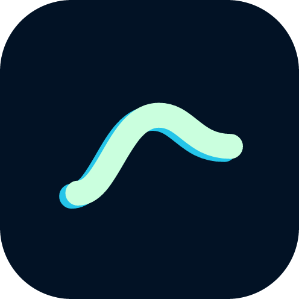
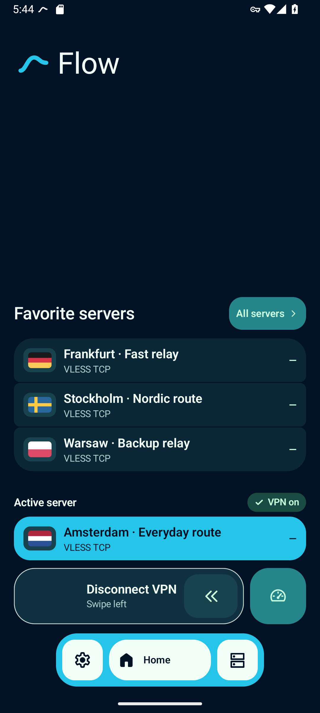
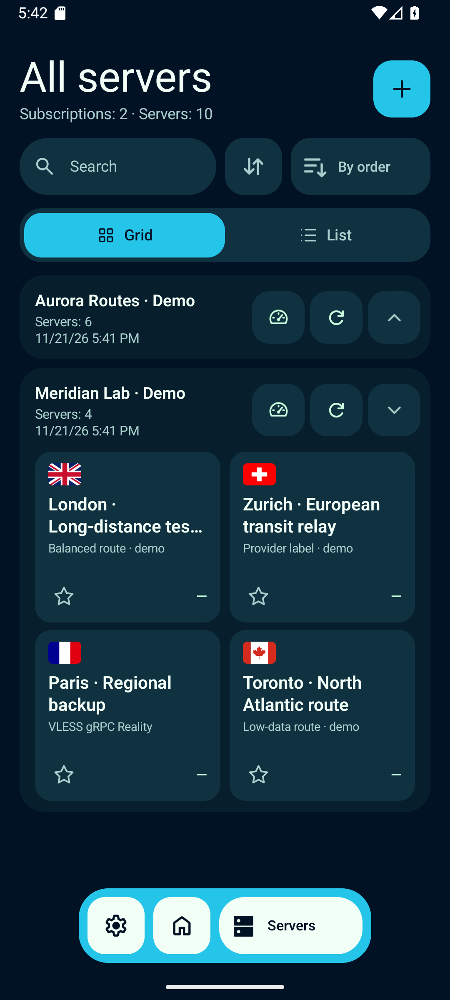
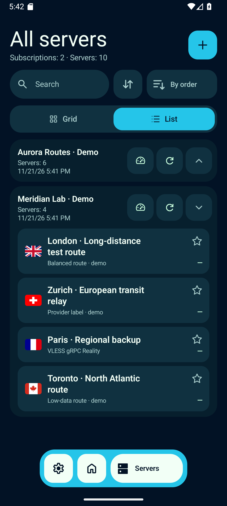
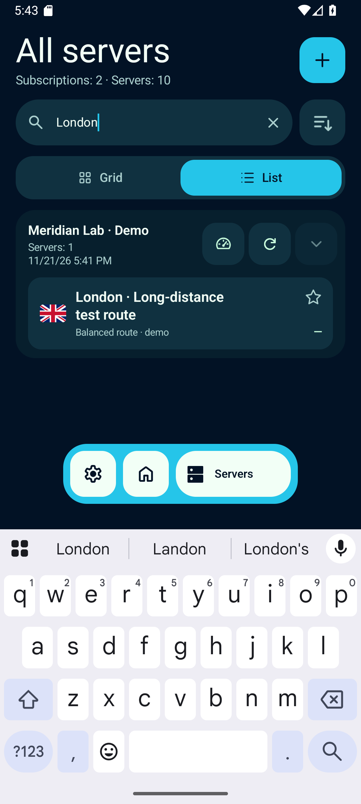
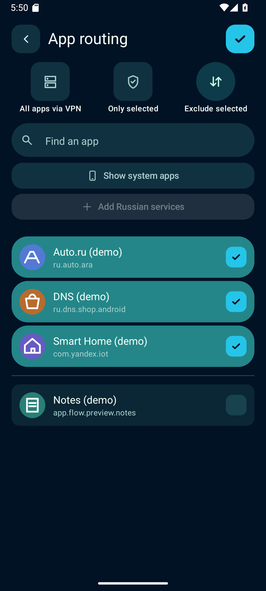
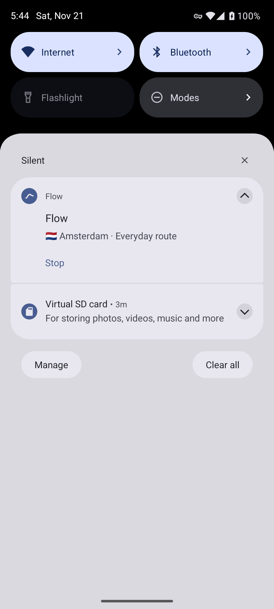

<p align="center">
  
</p>

<h1 align="center">Flow</h1>

<p align="center">A native Xray client for Android, built on v2rayNG.<br>Jetpack Compose · Material 3 Expressive</p>

<p align="center">
  <strong>English</strong> · <a href="README.ru.md"><kbd>Русский</kbd></a>
</p>

<p align="center">
  <a href="https://github.com/iriskaaf/Flow/releases/latest"></a>
  <a href="https://github.com/iriskaaf/Flow/releases"></a>
  <a href="LICENSE"></a>
  
</p>

<p align="center">
  <a href="https://github.com/iriskaaf/Flow/releases/latest/download/Flow.apk"><strong>Download Flow.apk</strong></a>
  · <a href="https://github.com/iriskaaf/Flow/releases">Release archive</a>
  · <a href="https://github.com/iriskaaf/Flow/issues">Report an issue</a>
</p>

## Screenshots

Captured in Flow with demo subscriptions and sample apps.

<table>
  <tr>
    <th>Connection and favorites</th>
    <th>Server grid</th>
    <th>Server list</th>
  </tr>
  <tr>
    <td></td>
    <td></td>
    <td></td>
  </tr>
  <tr>
    <th>Expanded search</th>
    <th>Per-app routing</th>
    <th>System VPN notification</th>
  </tr>
  <tr>
    <td></td>
    <td></td>
    <td></td>
  </tr>
</table>

## Features

- Import profiles and subscriptions from links, the clipboard or QR codes. Compatible HTTPS providers can use a per-provider hardware ID (HWID).
- Browse servers in a grid or list. Search, sort by latency, reorder subscriptions and keep favorite servers on the home screen.
- Route all apps, only selected apps or all except selected apps. A preset can select supported Russian services that are installed on the device.
- Connect from the Android Quick Settings tile and use the Flow palette or system colors.
- Check for and install signed updates from GitHub Releases in the app.

### Native Dynamic Island

Flow publishes its active VPN status through the system notification. On compatible Android 16 and newer devices, it requests a native [Live Update](https://developer.android.com/develop/ui/views/notifications/live-update) chip with the Flow icon and profile country. The regular VPN notification is available across supported Android versions when notifications are enabled. Chip availability and placement depend on the firmware and notification permissions. Xiaomi Super Island additionally requires manufacturer approval for the app. [Integration details](README.Flow.md#статус-vpn-в-системе)

Enable the feature in [Settings → Dynamic Island](docs/screenshots/island-settings.png). The Android 16 test image rendered the regular VPN notification shown above.

## Install

1. Download the universal `Flow.apk` from the [latest release](https://github.com/iriskaaf/Flow/releases/latest) and open it on Android 7.0 or newer.
2. In **Servers**, use **+** to add a profile or subscription. Flow uses the server defined by your configuration.
3. Select a server and connect on the home screen. Android asks you to approve the VPN connection on first use.

### Updates

Go to **Settings → About → Check for updates**. Flow downloads the latest stable APK from GitHub, checks the SHA-256 digest and verifies that the signing certificate matches the installed app. Android prompts you to confirm installation.

## Build from source

Use JDK 21 and Android SDK Platform 37. Open `V2rayNG` in Android Studio or use the command line.

```sh
cd V2rayNG
./gradlew :app:assemblePlaystoreDebug :app:testPlaystoreDebugUnitTest
```

On Windows, use `gradlew.bat`. Find the APK in `V2rayNG/app/build/outputs/apk/playstore/debug/`. Native libraries for `arm64-v8a`, `armeabi-v7a`, `x86_64` and `x86` are included. Local debug builds use your environment's signing key.

## Design and license

- [Flow design in Figma](https://www.figma.com/design/aZIeNjiyeOGRtb2uTJ8f8j/XPRMNTS?node-id=5724-1740)
- Based on [v2rayNG 2.1.8](https://github.com/2dust/v2rayNG/tree/2.1.8), with [Xray-core](https://github.com/XTLS/Xray-core) via [AndroidLibXrayLite](https://github.com/2dust/AndroidLibXrayLite/tree/v26.5.19) and [HEV SOCKS5 Tunnel](https://github.com/heiher/hev-socks5-tunnel/tree/dfabaa9cadf8894eb8ebfa0f75b1fee331869b34)
- [GPL-3.0](LICENSE)
